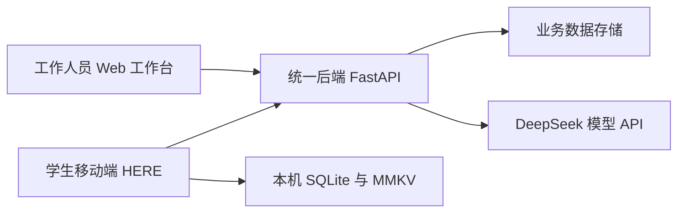

# HERE 学生移动端

HERE 是面向高校学生的心理支持与校园安全应用。学生可以通过手机表达困扰、记录当天状态，并使用位置与紧急联系等辅助功能；配套 Web 平台面向校园工作人员，承担预警工单、人工转介和知识资料管理等工作。

学生移动端基于 React Native、Expo 和 TypeScript。系统组成见[项目说明](../README.md)。

> 项目处于原型开发与持续迭代阶段。当前已接入的功能、界面占位和后续研究设计在下文分别说明。AI 用于辅助交流，不提供诊断，也不替代专业心理服务或紧急救援。

## 产品设计

项目从早期的个人安全与亲友守护原型，逐步收敛到高校学生场景。当前首页围绕三个使用任务组织：

- **记录状态**：用“还不错、一般、有点累”记录今天的感受。
- **开始交流**：从“聊一聊”进入 AI 对话，表达困扰并整理想法。
- **使用辅助工具**：查看当前位置、打开报平安短信草稿，或进入紧急求助流程。

应用底部导航为“首页、统计、我的”。校园帮助、预约和求助后续属于正在完善的产品方向，当前部分入口明确显示“待开放”。

## 当前功能

以下状态来自 `dev` 分支源码，不代表全部功能均已完成真机或生产环境验收。

| 模块      | 当前实现                       | 使用条件与边界                                |
| ------- | -------------------------- | -------------------------------------- |
| 账号与资料   | 学生登录、注册、资料编辑、登录状态保存        | 依赖统一后端；注册时需取得可用学院列表                    |
| 每日状态    | 三档状态选择，按账号与本地日期保存、回读       | 使用本地 SQLite，不代表已同步到服务器                 |
| AI 对话   | 多轮消息、加载状态、失败提示、按用户保存本机聊天历史 | 依赖后端模型服务；本机保存最多 100 条，请求携带最近 10 条非错误消息 |
| 首页与导航   | 新版首页、状态卡片、聊天入口、位置卡片及底部导航   | 部分校园服务仍为占位入口                           |
| 定位与轨迹   | 地图展示、轨迹记录与回顾、电子围栏相关页面与逻辑   | 依赖地图配置、设备权限与原生运行环境                     |
| 联系人与报平安 | 联系人管理、生成含位置信息的短信草稿         | 打开系统短信应用后，由用户确认发送                      |
| 紧急求助与预警 | 求助页面、预警提交、本地待发送队列与补发逻辑     | 依赖后端及接收人员配置；本地入队不等于已送达                 |
| 统计      | 活动与预警数据展示、AI 安全建议入口        | 展示结果不应解释为心理诊断                          |

代码中保留了早期长辈模式、跌倒告警和救援相关页面。相关页面的存在不代表已经接入真实硬件、自动检测或专业救援服务。

### 已知未完成项

- 校园帮助、预约及首页“后续安排”仍有待开放内容。
- 忘记密码页面已建立，短信验证码服务尚未开通，不能在该页面完成密码重置。
- 聊天记录目前保存在本机，尚不能据此承诺跨设备同步或跨会话长期记忆。
- 聊天与预警是不同接口，当前不能宣称“AI 自动识别高危意图并完成预警转介”。
- 硬件页面当前为占位实现。
- 生产环境 API 默认使用占位域名，发布前必须配置实际服务地址。
- `app.json` 引用的 iOS 图标与 Web favicon 在当前提交中缺失，尝试对应平台前需先补齐资源或调整配置。

## 系统组成



模型请求由后端发出，**不要将 DeepSeek 等服务端密钥放进移动端**。以 `EXPO_PUBLIC_` 开头的配置会进入客户端，应仅用于允许公开的客户端配置。

网页地图需要高德开放平台“Web 端（JS API）”Key，配置为 `EXPO_PUBLIC_AMAP_JS_KEY`，并在高德控制台限制允许访问的网页域名。逆地理编码使用的是另一类“Web 服务”Key，配置为 `EXPO_PUBLIC_AMAP_WEB_KEY`。生产环境的 JS API 安全密钥应只保存在同域反向代理服务器中，不能放入 `EXPO_PUBLIC_` 变量或前端构建包。默认代理路径为 `/_AMapService`。

## 技术栈

| 层次    | 主要技术                                            |
| ----- | ----------------------------------------------- |
| 应用框架  | Expo 54、React Native 0.81、React 19              |
| 语言    | TypeScript                                      |
| 页面导航  | React Navigation                                |
| 本地数据  | Expo SQLite、React Native MMKV                   |
| 位置与地图 | Android 使用 react-native-amap3d，Web 使用高德 JS API、Geolocation |
| 界面交互  | Expo Linear Gradient、Reanimated、Gesture Handler |
| 质量检查  | TypeScript、ESLint、Jest                          |

项目基于 Ignite 工程结构演进，保留了部分模板与早期原型代码。

## 目录结构

```text
app/
  components/             通用界面组件
  config/                 开发与生产配置
  context/                登录状态与应用上下文
  navigators/             登录流程、底部导航与业务页面路由
  screens/
    MainScreen/           首页、每日状态与首页组件
    AiChatScreen.tsx      AI 对话
    LoginScreen.tsx       登录与注册
    StatisticsScreen.tsx  统计
    SettingsScreen.tsx    我的
  services/
    hereApi.ts            统一后端请求与错误处理
    alertSync.ts          预警提交与待发送队列处理
    database/             SQLite、迁移与数据访问
    LocationRecorder.ts   定位、轨迹与围栏逻辑
  theme/                  主题
  utils/                  工具函数
assets/                   图片与图标
plugins/                  Expo 原生配置插件
scripts/                  Android 启动与构建辅助脚本
test/                     测试环境配置
.env.example              环境变量示例
```

## 本地运行

### 1. 环境准备

- Node.js 20 或更高版本、npm、Git。
- Android 开发环境：JDK 17、Android SDK，以及模拟器或开启 USB 调试的 Android 真机。
- 可访问的 HERE 后端。账号、学院列表、AI 对话和预警等功能依赖后端；仅启动移动端不会启动这些服务。

本项目使用原生模块和 Expo Development Build，**不能仅用 Expo Go 作为完整运行环境**。Windows 用户建议先运行 Android；仓库虽包含 iOS 与 Web 命令，但本说明不保证这两个平台已完成验证。

### 2. 从仓库根目录进入移动端并安装依赖

```powershell
Set-Location mobile
npm ci
Copy-Item .env.example .env.local
```

编辑 `.env.local`：

```dotenv
EXPO_PUBLIC_HERE_API_URL=http://127.0.0.1:8000/api/v1
EXPO_PUBLIC_AMAP_ANDROID_KEY=
EXPO_PUBLIC_AMAP_JS_KEY=
EXPO_PUBLIC_AMAP_WEB_KEY=
```

高德配置分别用于 Android SDK、网页 JS API 地图和 Web 服务逆地理编码，需申请对应类型的 Key 并配置适用的应用限制。网页 JS API Key 需允许本地开发域名及正式站点域名。Android SDK Key 需匹配包名及签名信息；当前包名为 `com.here`。JS API 安全密钥由生产服务器的 Nginx 代理使用，不写入本地前端环境文件。

真实配置文件不会提交到仓库。修改环境变量后，请重新启动开发服务；涉及原生配置的变更可能需要重新构建应用。

### 3. 启动配套后端

按[后端启动说明](../backend/README.md)启动服务，并为预警演示配置学院和对应辅导员。

默认本地 API 为 `http://127.0.0.1:8000/api/v1`。AI 对话还需要在**后端环境文件**中配置模型服务密钥和模型名称。

### 4. 连接设备并运行

USB 调试时，可先检查设备并映射后端端口：

```powershell
adb devices
adb reverse tcp:8000 tcp:8000
npm run android
```

Windows 下的 `npm run android` 会使用仓库中的辅助脚本处理较长构建路径，并尝试建立后端端口映射。该脚本会使用 `H:`、`R:` 或 `X:` 中可用的虚拟盘符。

开发构建已安装后，后续启动开发服务可以使用：

```powershell
npm start
```

如果改用局域网连接，将 API 地址改为电脑在局域网中的地址，并确保手机能访问后端监听端口。例如：

```dotenv
EXPO_PUBLIC_HERE_API_URL=http://你的电脑局域网IP:8000/api/v1
```

手机上的 `127.0.0.1` 指手机自身；USB 方案依赖端口映射，局域网方案则需要实际可访问的电脑地址。局域网连接还需配置后端监听地址及相应防火墙规则。

## 开发检查

```powershell
# TypeScript 类型检查
npm run compile

# 只检查代码规范，不自动修改
npm run lint:check

# 运行现有 Jest 测试
npm test -- --runInBand
```

`npm run lint` 会自动修改代码，执行前请确认工作区状态。上述命令的存在不表示检查已全部通过；结果应以当前提交的实际执行记录为准。原生构建和真机流程需另外验证。

## 建议验证的使用流程

1. 启动后端，确认 API 地址与手机连接方式正确。
2. 完成学生注册、登录和个人资料填写。
3. 在首页记录状态，返回页面或重新打开应用，检查同账号回读结果。
4. 进入 AI 对话，发送普通交流内容，检查加载、回复及历史恢复。
5. 使用明确标记的测试数据提交预警，在 Web 工作台检查对应工单。
6. 检查断网提示、待发送状态及补发结果，不将“本机已保存”视为“工作人员已收到”。

展示和测试请使用虚构或脱敏数据，避免提交真实学生聊天、位置、账号密码及个人档案。

## 后续研究与迭代

当前移动端通过统一后端调用外部大模型。以下内容属于研究设计或后续工作，不能作为本分支已经完成的成果：

- 使用经过脱敏和专业审核的对话数据，研究 LoRA／AdaLoRA 等参数高效微调方法。
- 接入校园与心理支持知识资料，研究检索增强及 GraphRAG，并提供可核查的回答依据。
- 研究 Rasa 等对话调度机制、明确的风险处理规则与人工接手流程。
- 完善校园帮助、预约、求助进度反馈和数据控制。
- 完善异常网络、账号隔离、权限和多设备场景的验证。

详细产品讨论见 [产品需求草案](../docs/product/HERE_PRD_v0.1_2026-11-05.md)。草案中的目标、指标及待开发能力均不等于已交付成果。

